# Data Analyst Portfolio

**End-to-end analytics projects using Excel, SQL, Python, and Power BI**


This repository contains two capstone projects. Each one follows the full analyst workflow on a real-world dataset: **explore and summarise in Excel → clean and query in SQL → analyse statistically in Python → communicate in dashboards**. The goal throughout is to turn raw data into business decisions.

| # | Project | Domain | Dataset | Tools |
|---|---------|--------|---------|-------|
| 01 | [**RetailVC: Customer & Marketing Campaign Analytics**](#01--retailvc-customer--marketing-campaign-analytics) | Retail / Marketing | 2,240 customers × 30 features | Excel · MySQL · Python |
| 02 | [**ReadmitGuard: Hospital Readmission Analytics**](#02--readmitguard-hospital-readmission-analytics) | Healthcare | 101,766 patient encounters × 50 features | Excel · MySQL · Python · Power BI |

---

## Skills Demonstrated

| Skill area | What I did | Where |
|------------|------------|-------|
| **Excel** | Descriptive statistics (Analysis ToolPak), PivotTables, PivotCharts, cross-tabulations, box & whisker plot, histogram, written observations | [01](01-RetailVC-Marketing-Analytics/excel), [02](02-ReadmitGuard-Healthcare-Analytics/excel) |
| **SQL (MySQL)** | Schema and table design, data loading, NULL handling, text-to-`DATE` conversion with `STR_TO_DATE`, `ALTER TABLE`, `CASE` segmentation, `UNION ALL`, subqueries, aggregations, rates and percentages | [01](01-RetailVC-Marketing-Analytics/sql), [02](02-ReadmitGuard-Healthcare-Analytics/sql) |
| **Python** | Data cleaning, group-wise imputation, feature engineering, IQR outlier detection and capping, ordinal and one-hot encoding, correlation analysis, Welch's t-test, visualisation (matplotlib / seaborn) | [01](01-RetailVC-Marketing-Analytics/python), [02](02-ReadmitGuard-Healthcare-Analytics/python) |
| **Power BI** | Interactive one-page dashboard with DAX KPI measures, 6 slicers, clustered column and scatter visuals | [02](02-ReadmitGuard-Healthcare-Analytics/powerbi) |
| **Communication** | Business framing, written observations, insights and recommendations | Throughout |

---

## Repository Structure

```
.
├── README.md                                  ← you are here
├── requirements.txt                           ← Python dependencies
│
├── 01-RetailVC-Marketing-Analytics/
│   ├── data/        marketing_campaign.csv
│   ├── docs/        problem_statement.pdf
│   ├── excel/       RetailVC_Retail_Analytics.xlsx
│   ├── sql/         retailvc_retail_analytics.sql
│   ├── python/      retailvc_marketing_eda.ipynb
│   └── images/      excel/ · python/          ← screenshots used below
│
└── 02-ReadmitGuard-Healthcare-Analytics/
    ├── data/        diabetic_data.csv · descriptive_statistics.csv
    ├── excel/       diabetic_data.xlsx
    ├── sql/         readmitguard_analysis.sql
    ├── python/      readmitguard_eda.ipynb
    ├── powerbi/     ReadmitGuard_Dashboard.pbix
    └── images/      excel/ · python/ · powerbi/
```

---

## 01 · RetailVC: Customer & Marketing Campaign Analytics

### Business problem

RetailVC provides analytics services to retailers. The client wanted to understand **who its customers are, how they buy, and who responds to marketing campaigns**, so that future promotions reach the right people and deliver a better **return on investment (ROI)**.

### Project intention

- Profile customers by demographics (age, education, marital status, income, household).
- Measure purchasing behaviour across product categories and channels.
- Find which customer traits are linked to a positive campaign **Response**.
- Prepare a clean, model-ready dataset for future response prediction.

### Dataset

`marketing_campaign.csv`: **2,240 customers, 30 columns**. It covers demographics, spend on six product categories (wine, fruit, meat, fish, sweets, gold) over two years, purchases by channel (web, catalogue, store, deals), website visits, acceptance of five past campaigns, and the target `Response` to the latest campaign.

### Tech stack

`Excel` (PivotTables, PivotCharts, Analysis ToolPak, Box & Whisker, Histogram) · `MySQL` · `Python` (pandas, NumPy, matplotlib, seaborn, SciPy) · `Jupyter`

---

### Excel: Data Exploration

📁 [`excel/RetailVC_Retail_Analytics.xlsx`](01-RetailVC-Marketing-Analytics/excel/RetailVC_Retail_Analytics.xlsx)

| Task | Technique | Result |
|------|-----------|--------|
| Statistical summary of all numeric features | Analysis ToolPak → Descriptive Statistics | 24 variables: mean, median, mode, SD, variance, kurtosis, skewness, range |
| Enrolments by year | PivotTable + line PivotChart | Peak of **1,189** sign-ups in 2013 |
| Response × Education | Cross-tab PivotTable | **334** responders out of 2,240 (14.9%) |
| Income distribution | Box & Whisker chart | Extreme outlier at **$666,666** |
| Customer age | Calculated column + Histogram | Ages centre on the mid-50s; birth years such as 1893 reveal data-entry errors |
| Response × Marital status | Clustered column PivotChart | Single, divorced and widowed customers respond more than partnered ones |

**Enrolments by year (PivotTable and line chart with written observation)**
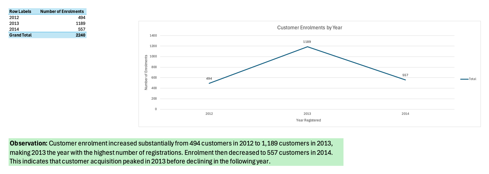

**Campaign response by marital status (PivotTable and clustered column chart)**
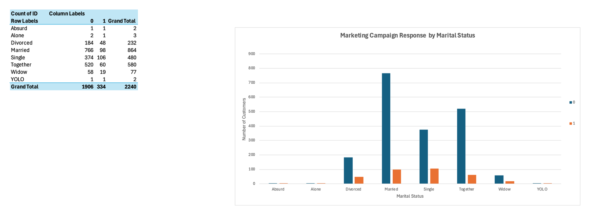

<table>
<tr>
<td width="50%"><b>Income: box & whisker plot</b><br>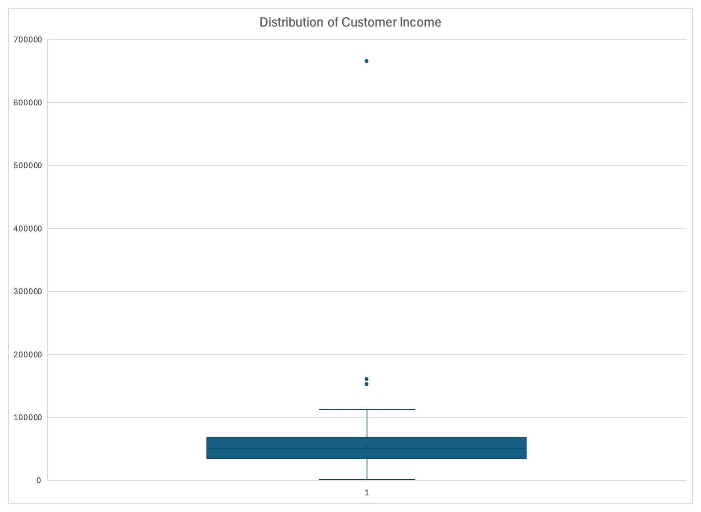</td>
<td width="50%"><b>Customer age: histogram</b><br>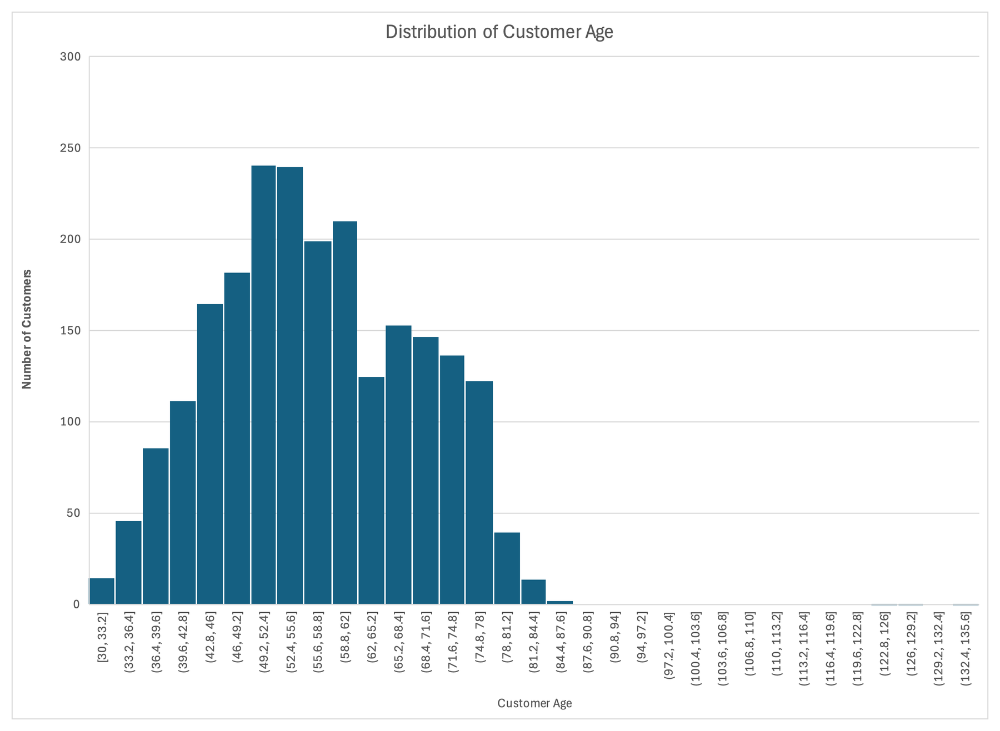</td>
</tr>
</table>

<details>
<summary><b>More Excel outputs: Response × Education cross-tab and statistical summary</b></summary>

**Response × Education cross-tab with observation**
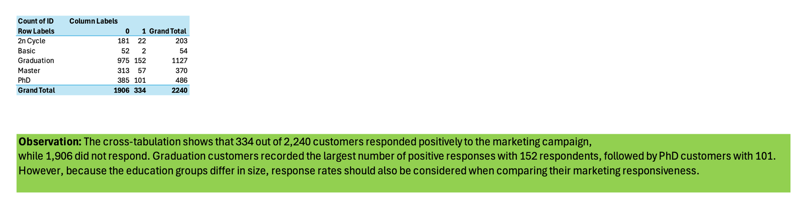

**Descriptive statistics (Analysis ToolPak, first 8 of 24 variables)**
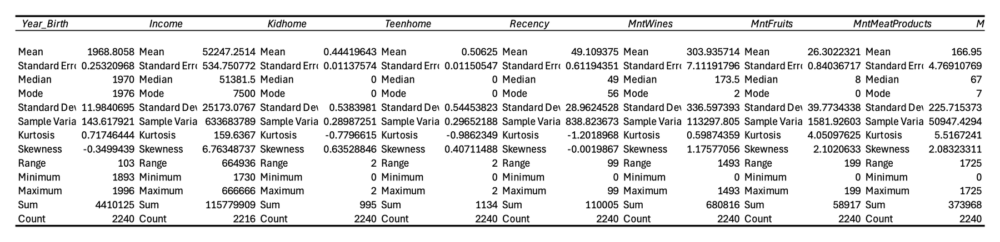

</details>

---

### SQL: Data Loading, Cleaning & Analysis (MySQL)

📁 [`sql/retailvc_retail_analytics.sql`](01-RetailVC-Marketing-Analytics/sql/retailvc_retail_analytics.sql)

The script creates the `retail_data` schema and loads the raw CSV. It then cleans the data inside the database and answers 12 business questions.

**Cleaning: blank income → `NULL` → numeric type, and text date → real `DATE`**

```sql
UPDATE marketing_campaign
SET Income = NULL
WHERE TRIM(Income) = '';

ALTER TABLE marketing_campaign
MODIFY COLUMN Income DECIMAL(12,2) NULL;

ALTER TABLE marketing_campaign ADD COLUMN Dt_Customer_Clean DATE;

UPDATE marketing_campaign
SET Dt_Customer_Clean = STR_TO_DATE(Dt_Customer, '%d-%m-%Y');

-- validate: 0 failed conversions, then swap the columns
SELECT COUNT(*) AS Failed_Date_Conversions
FROM marketing_campaign
WHERE Dt_Customer IS NOT NULL AND Dt_Customer_Clean IS NULL;
```

**Segmentation: derived age groups with `CASE`, then web visits per segment**

```sql
UPDATE marketing_campaign
SET Age_Group =
    CASE
        WHEN Calculated_Age BETWEEN 18 AND 25 THEN '18-25'
        WHEN Calculated_Age BETWEEN 26 AND 35 THEN '26-35'
        WHEN Calculated_Age BETWEEN 36 AND 45 THEN '36-45'
        WHEN Calculated_Age BETWEEN 46 AND 55 THEN '46-55'
        ELSE '56+'
    END;

SELECT Age_Group, ROUND(AVG(NumWebVisitsMonth), 2) AS Average_Monthly_Visits
FROM marketing_campaign
GROUP BY Age_Group;
```

**Selected query results**

| Business question | Answer |
|-------------------|--------|
| Total customers | **2,240** (24 with missing income) |
| Top product category by spend | **Wine: 680,816**, then Meat 373,968, Gold 98,609, Fish 84,057, Sweets 60,621, Fruit 58,917 |
| Last-campaign response | 1,906 no / **334 yes** |
| Average income of responders | **$60,210**, compared with $50,839 for non-responders |
| Accepted offers per campaign | Cmp1 144 · Cmp2 **30** · Cmp3 163 · Cmp4 **167** · Cmp5 163 |
| Average children / teenagers per household | 0.44 / 0.51 |

---

### Python: Exploratory Data Analysis & Hypothesis Testing

📁 [`python/retailvc_marketing_eda.ipynb`](01-RetailVC-Marketing-Analytics/python/retailvc_marketing_eda.ipynb)

**Pipeline**
1. **Clean:** coerce `Income` to numeric; parse `Dt_Customer` to datetime; group 8 marital-status labels (including the invalid "YOLO" and "Absurd") into *Partner* and *Single*.
2. **Impute:** fill the 24 missing incomes with the **mean income of the same Education × Marital-Status group**, which is more precise than a single global mean.
3. **Engineer features:** `Calculated_Age`, total `Spending`, `Children_Count`, `Has_Children`, `Total_Purchases`.
4. **Treat outliers:** cap at Q1 − 1.5·IQR and Q3 + 1.5·IQR.
5. **Encode:** ordinal encoding for Education and one-hot encoding for marital status, so the data is ready for modelling.
6. **Analyse:** correlation matrix and heatmap, plus a **Welch's t-test** on income for responders vs non-responders.

<table>
<tr>
<td width="50%">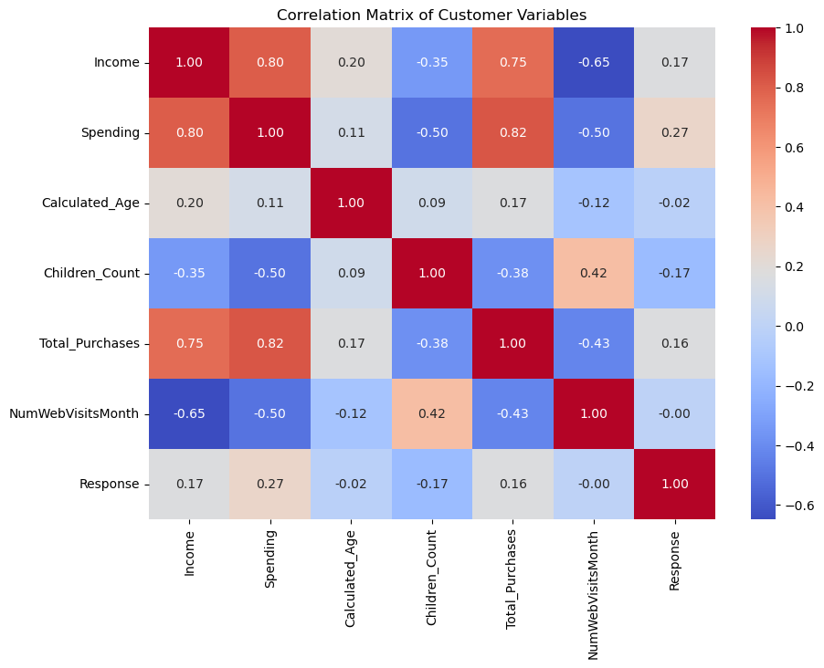</td>
<td width="50%">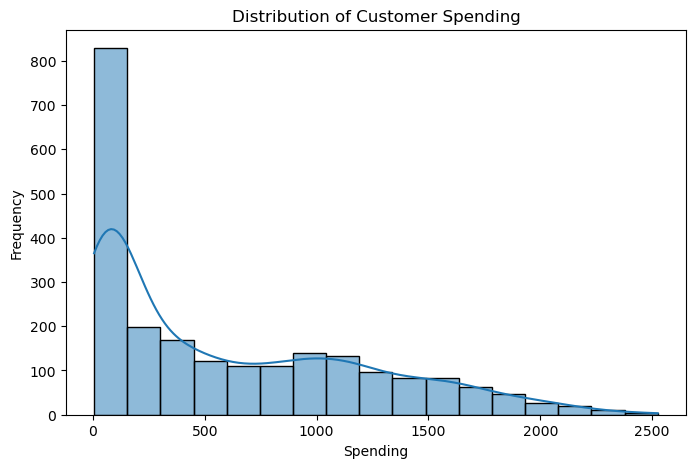</td>
</tr>
<tr>
<td width="50%">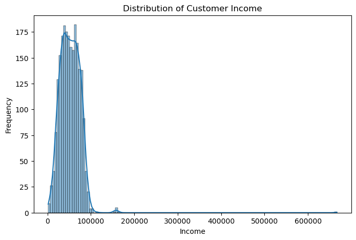</td>
<td width="50%">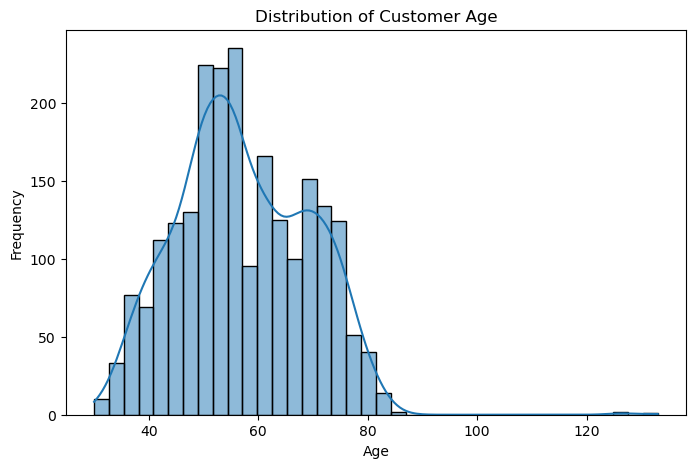</td>
</tr>
</table>

**Hypothesis test.** H₀ states that responders and non-responders have the same mean income.
Welch's t-test gives **t = 7.26** and **p ≈ 1.9 × 10⁻¹²**. **H₀ is rejected**: responders have significantly higher income.

---

### Key insights & recommendations

| Insight | Recommendation |
|---------|----------------|
| Income and spending are strongly correlated (**r = 0.80**). Of the variables tested, spending has the strongest link to Response (r = 0.27). | Score customers on spending to prioritise who receives campaigns. |
| Response rate rises with education, from **3.7%** (Basic) to **20.8%** (PhD). | Design premium offers for highly educated segments. |
| Single, divorced and widowed customers respond at **21–25%**, compared with **10–11%** for married or cohabiting customers. | Run campaigns built for single-person households. |
| Households with more children spend less (r = −0.50) and visit the website more (r = +0.42). | Use digital, value-led promotions for families. |
| Campaign 2 converted only **30** customers, while campaigns 3–5 converted about 165 each. | Review Campaign 2's offer and audience before reusing it. |
| Wine and meat account for **~77%** of all spend. | Lead future promotions with these two categories. |
| The data contains quality issues: income of $666,666, birth years before 1900, and invalid marital labels. | Add validation rules at the point of data capture. |

---

## 02 · ReadmitGuard: Hospital Readmission Analytics

### Business problem

Hospital readmissions within **30 days** of discharge are costly, and in many health systems they are penalised. ReadmitGuard examines 10 years of diabetic patient encounters from US hospitals to find **which patients are readmitted and what their encounters have in common**. The aim is to help care teams focus discharge planning and follow-up where it matters most.

### Project intention

- Measure the size of the readmission problem (overall and by segment).
- Profile patients by age, gender and race, and profile encounters by diagnoses, procedures, medications and admission type.
- Identify the variables and outliers that point to high-risk patients.
- Give stakeholders a **self-service Power BI dashboard** to explore readmissions.

### Dataset

`diabetic_data.csv`: **101,766 encounters, 50 columns**, from the *Diabetes 130-US Hospitals (1999–2008)* dataset. It covers demographics, admission and discharge details, length of stay, lab tests, procedures, medications, three ICD-9 diagnosis codes, 23 diabetes drugs, and the target `readmitted` (`<30`, `>30`, `NO`).

### Tech stack

`Excel` (PivotTables, PivotCharts) · `MySQL` · `Python` (pandas, matplotlib) · `Power BI` (DAX measures, slicers) · `Jupyter`

---

### Power BI: Interactive Dashboard

📁 [`powerbi/ReadmitGuard_Dashboard.pbix`](02-ReadmitGuard-Healthcare-Analytics/powerbi/ReadmitGuard_Dashboard.pbix)

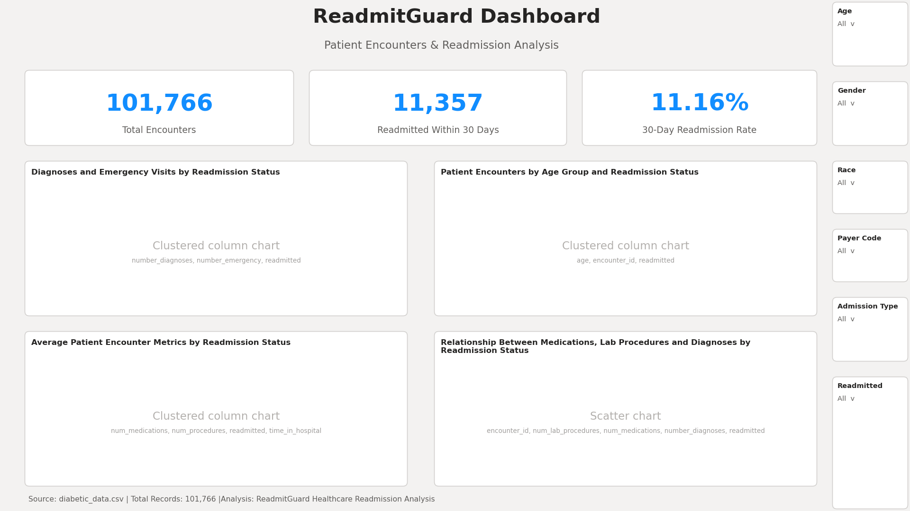

*Report page layout generated from the `.pbix` file, with KPI values calculated from the dataset. Open the `.pbix` in Power BI Desktop to use it interactively.*

| Component | Details |
|-----------|---------|
| **KPI cards (DAX measures)** | `Total Encounters` = **101,766** · `Readmitted Within 30 Days` = **11,357** · `30-Day Readmission Rate` = **11.16%** |
| **Visuals** | Encounters by age group × readmission status · Diagnoses and emergency visits by readmission status · Encounter metrics by readmission status · Scatter of medications vs lab procedures (size = diagnoses, colour = readmission) |
| **Slicers** | Age · Gender · Race · Payer code · Admission type · Readmission status |
| **Model** | `diabetic_data` fact table plus a dedicated `_Measures` table |

---

### Excel: PivotTable Analysis

📁 [`excel/diabetic_data.xlsx`](02-ReadmitGuard-Healthcare-Analytics/excel/diabetic_data.xlsx)

**30-day readmissions by age group and gender (filtered PivotTable and clustered column chart)**
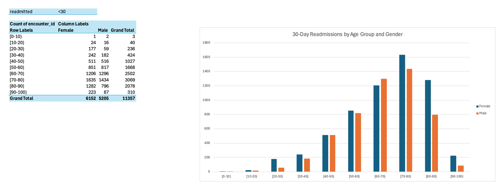

<table>
<tr>
<td width="50%"><b>Encounters by readmission category</b><br>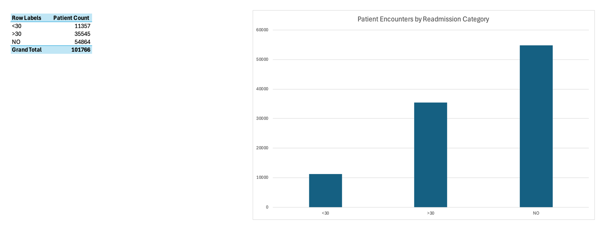</td>
<td width="50%"><b>Race distribution of encounters</b><br>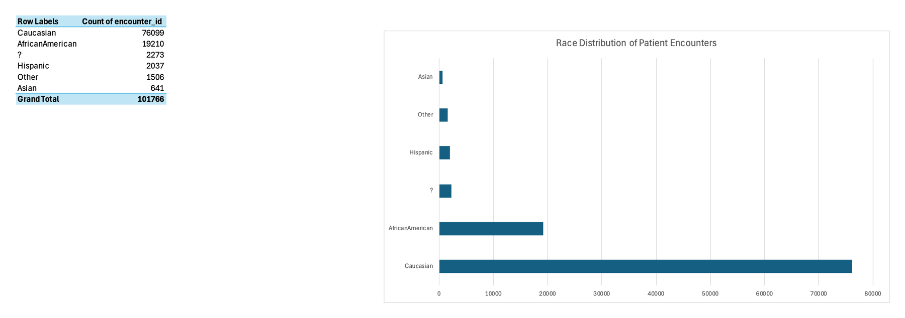</td>
</tr>
</table>

---

### SQL: Healthcare Queries (MySQL)

📁 [`sql/readmitguard_analysis.sql`](02-ReadmitGuard-Healthcare-Analytics/sql/readmitguard_analysis.sql)

**Top 10 diagnoses across all three diagnosis columns (`UNION ALL` reshapes wide data into long format)**

```sql
SELECT diagnosis_code, COUNT(*) AS Total
FROM (
    SELECT diag_1 AS diagnosis_code FROM diabetic_data
    UNION ALL
    SELECT diag_2 FROM diabetic_data
    UNION ALL
    SELECT diag_3 FROM diabetic_data
) diagnoses
WHERE diagnosis_code <> '?'
GROUP BY diagnosis_code
ORDER BY Total DESC
LIMIT 10;
```

**30-day readmission rate by payer (conditional aggregation)**

```sql
SELECT payer_code,
       COUNT(*) AS Total,
       SUM(CASE WHEN readmitted = '<30' THEN 1 ELSE 0 END) AS Readmitted30,
       ROUND(SUM(CASE WHEN readmitted = '<30' THEN 1 ELSE 0 END) * 100 / COUNT(*), 2) AS Percentage
FROM diabetic_data
GROUP BY payer_code
ORDER BY Percentage DESC;
```

**Selected query results**

| Business question | Answer |
|-------------------|--------|
| Total encounters | **101,766** |
| Readmitted at any time (`<30` + `>30`) | **46,902 (46.09%)** |
| Most common diagnoses (ICD-9) | **428** Heart failure (18,101) · **250** Diabetes (17,861) · **276** Fluid/electrolyte disorders (13,816) · **414** Chronic ischaemic heart disease (12,895) · **401** Hypertension (12,371) |
| Average length of stay by admission type | 3.1 to 4.9 days; longest for type 7 (4.86 days) |
| Most common number of procedures | **0** (46,652 encounters) |
| Highest 30-day readmission rate by payer | **OG: 13.17%**; the largest payer, MC (Medicare), is at 11.75% |

---

### Python: Exploratory Data Analysis

📁 [`python/readmitguard_eda.ipynb`](02-ReadmitGuard-Healthcare-Analytics/python/readmitguard_eda.ipynb)

**Pipeline:** profile the data → replace `?` placeholders with `NA` and audit missing values (`weight` is 97% missing, `max_glu_serum` 95%, `A1Cresult` 83%) → descriptive statistics exported to [`descriptive_statistics.csv`](02-ReadmitGuard-Healthcare-Analytics/data/descriptive_statistics.csv) → demographic distributions → age × readmission cross-tab → correlation matrix → diagnosis frequency → admission and discharge profiles → IQR outlier detection.

<table>
<tr>
<td width="50%">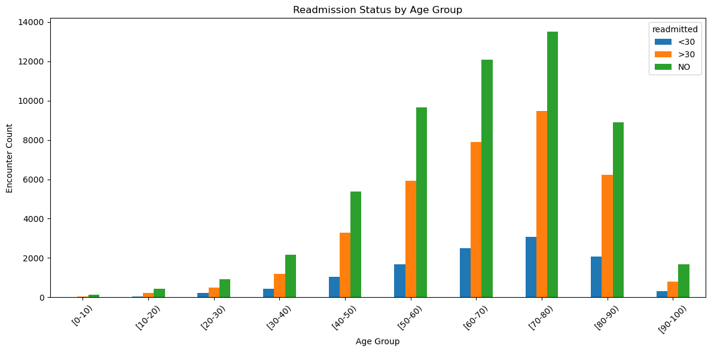</td>
<td width="50%">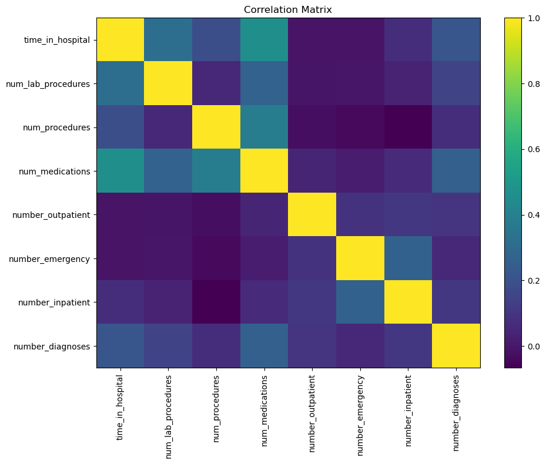</td>
</tr>
<tr>
<td width="50%">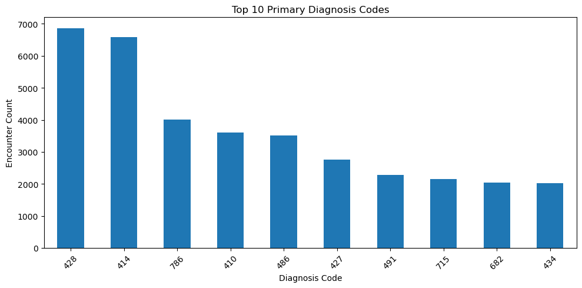</td>
<td width="50%">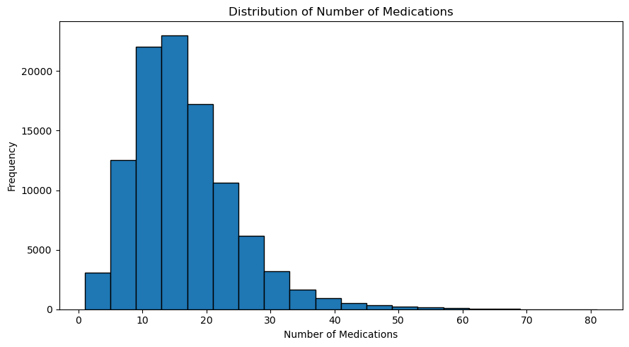</td>
</tr>
</table>

<details>
<summary><b>More Python charts: demographics, admissions and outlier box plots</b></summary>

<table>
<tr>
<td width="50%">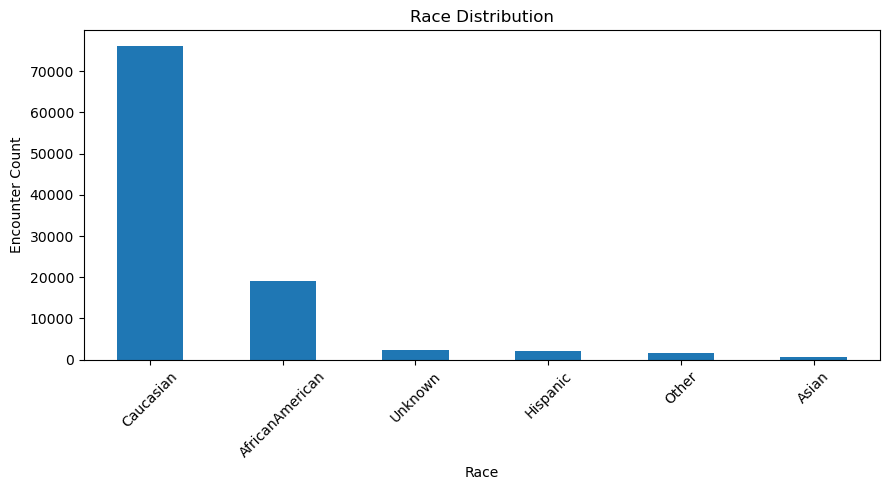</td>
<td width="50%">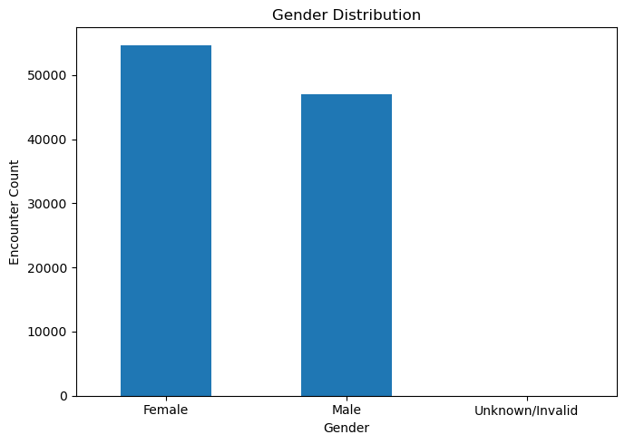</td>
</tr>
<tr>
<td width="50%">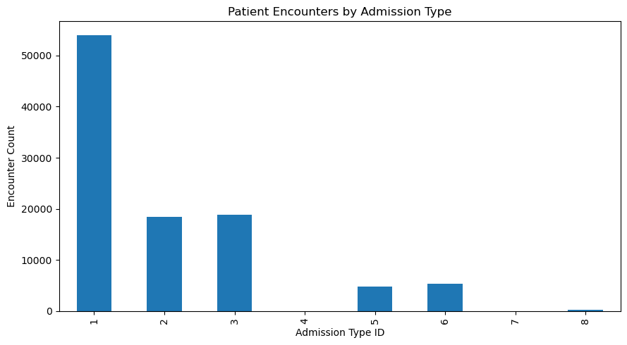</td>
<td width="50%">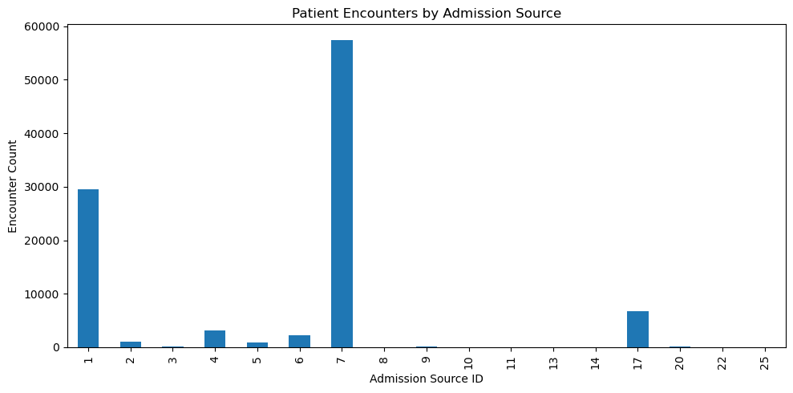</td>
</tr>
<tr>
<td width="50%">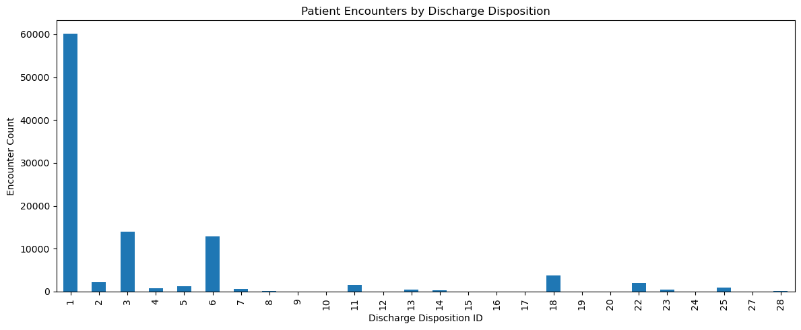</td>
<td width="50%">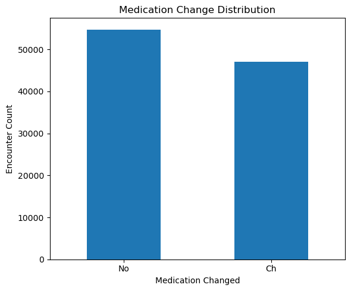</td>
</tr>
<tr>
<td width="50%">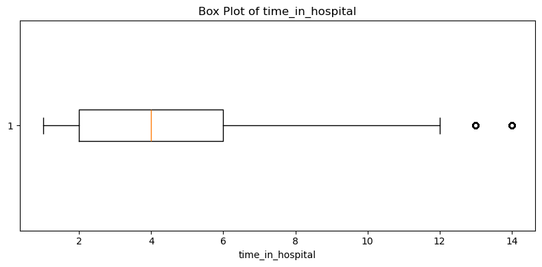</td>
<td width="50%">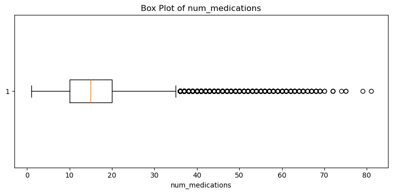</td>
</tr>
<tr>
<td width="50%">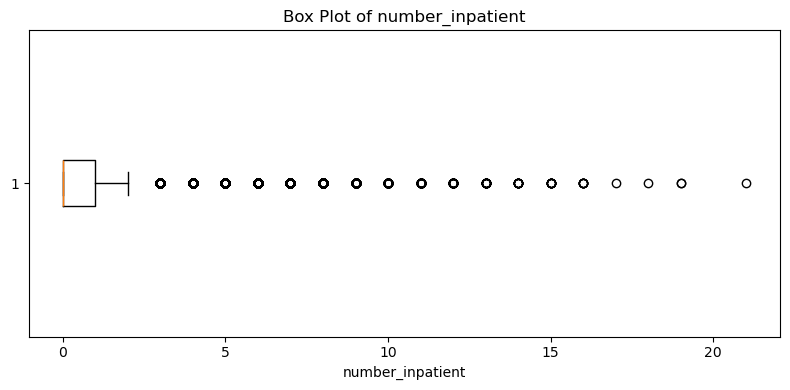</td>
<td width="50%">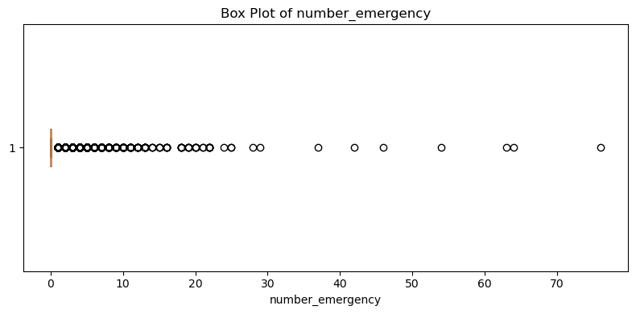</td>
</tr>
</table>

</details>

---

### Key insights & recommendations

| Insight | Recommendation |
|---------|----------------|
| **11.16%** of encounters end in readmission within 30 days, and **46.09%** are readmitted at some point. | Track the 30-day rate as the headline KPI, as the dashboard does. |
| Encounters for patients aged **60–90** make up the most 30-day readmissions (7,649 of 11,357). From age 70 upwards, women outnumber men, most clearly at 80+. | Prioritise discharge planning and follow-up calls for older patients. |
| **Heart failure (428)** is the single most common diagnosis, ahead of diabetes itself (250). | Coordinate care for diabetic patients who also have cardiac conditions. |
| Length of stay correlates moderately with medications (r = 0.47) and lab procedures (r = 0.32). | Use encounter intensity as an input to a future risk-scoring model. |
| Prior inpatient and emergency visits contain many outliers. | Keep these records, because they are likely the highest-risk patients. Do not remove them as noise. |
| `weight`, `max_glu_serum` and `A1Cresult` are mostly empty. | Improve capture of these clinical measurements, which are known risk factors. |

---

## How to Run

```bash
# 1. Python environment
pip install -r requirements.txt
jupyter notebook          # open the notebook from each project's /python folder

# 2. SQL (MySQL 8+)
#    Run the script in MySQL Workbench, importing the matching CSV from /data
#    with the Table Data Import Wizard after the CREATE TABLE step.

# 3. Excel: open the .xlsx in /excel (Microsoft 365 recommended for Box & Whisker and Histogram charts)
# 4. Power BI: open the .pbix in Power BI Desktop
```

---

## About Me

I am a data analyst who enjoys turning messy, real-world data into clear and actionable stories. I work across the whole analytics stack, from spreadsheets and SQL to Python and BI dashboards.

[](https://www.linkedin.com/in/lea-iradukunda/)
[](mailto:leairadukunda3@gmail.com)
[](https://github.com/leairadukunda3-ira)

⭐ *If you find this work interesting, feel free to star the repository or get in touch.*
